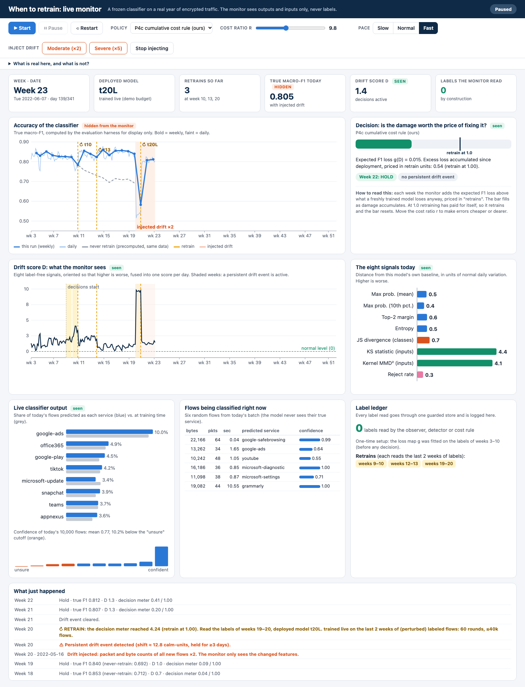

# Label-free, cost-aware retraining triage for encrypted traffic classifiers

A deployed, frozen traffic classifier (LightGBM, 50 services, CESNET-TLS-Year22) is
monitored **without ground-truth labels**. A composite drift score, change-point
detection and a cost model decide *when* retraining is worth its price. The classifier
is a fixed substrate. The contribution is the monitor-and-decide pipeline and the
harness that evaluates it against periodic, threshold and oracle policies.

> **Status:** see [Results](#results). Every number in this README is printed by a
> script in `scripts/` and stored under `results/`.

## Reproduce

```bash
python3 -m venv .venv && .venv/bin/pip install -e .     # pinned versions in pyproject.toml
./run_all.sh                                            # tests -> data -> steps 2-9
```

| step | script | output |
|---|---|---|
| tests | `pytest` (leakage tests run first) | 47+ assertions, non-zero exit on regression |
| 1 data | `scripts/01_fetch_data.py --dataset tls-year22 \| quic22` | `data/<ds>/days/YYYYMMDD.parquet` (resumable) |
| 2 reference model, P0 curve | `scripts/02_train_reference_classifier.py` | `p0_weekly.csv`, `p0_per_service_f1.csv` |
| 3-4 D(t) + go/no-go | `scripts/02b_signal_checkpoint.py` | `checkpoint_report.json` |
| 5-7 full replay | `scripts/03_run_replay.py --config configs/base.yaml` | `policy_comparison.csv`, `sensitivity.csv`, `oracle_*.csv`, ... |
| 8 QUIC | `scripts/04_run_quic_validation.py` | `quic_validation.json` |
| 9 figures | `scripts/05_make_report_figures.py <run_dir>` | `figures/*.png`, `summary_table.csv` |

Any config value can be overridden from the command line: `--set replay_end=20 --set 'sweeps.cost_ratio=[1,10]'`.

## Architecture

```
data/fetch.py      Zenodo -> uniform per-day sample      (labels + features)
data/loader.py     class subset, closed world, per-day cap (LABEL-BEARING)
        |  split in evaluation/harness.py
        +--> data/replay.py      StreamDay/WeeklyBatch: features only, forward-only next_week()
        +--> evaluation/sealed_store.py   labels only; caller + clock guarded
classifier/        LightGBM substrate; frozen_state = deployed generation
observer/          8 label-free signals -> composite D (oriented z-scores, per-generation baseline)
detection/         daily D -> STL(7) -> anchored normalisation -> PELT -> k-day persistence
decision/          g (isotonic, frozen) ; myopic rule (spec) ; cumulative rule ; P0-P5 policies
evaluation/        harness (memoised World), metrics, exact DP oracle, plots
pipeline.py        one year-run end to end
```

### How "label-free" is enforced (three layers)
1. **Static import graph** (`tests/test_no_label_leakage.py`, `tests/leakcheck.py`): no module
   in `observer/ detection/ decision/ classifier/ data/replay.py` may reach
   `evaluation/`, `data/loader.py` or `pipeline.py`, directly or transitively. The check
   covers every import form: `from pkg import mod`, relative imports, `importlib`
   and `__import__`. The checker is itself mutation-tested against 9 evasion forms.
2. **Runtime caller guard + clock** (`sealed_store.py`): accessors raise
   `LabelAccessError` unless called from `src.evaluation`/`src.pipeline`/scripts, and never
   return labels for a period after the simulation clock.
3. **Behavioural test**: P3/P4/P4c make *identical* decisions when the grading labels
   are replaced with garbage, while the oracle P5 changes, which proves the patch bites.

`decision/` never imports the store at all (stricter than the spec, which allowed
`calibration.py` to). The harness fetches calibration labels through
`get_calibration_labels` and passes plain arrays to `g.fit`.

## Design decisions that deviate from the spec, and why

Each was decided **before** the full-year results existed. Where a choice could look
tuned, the spec's literal variant is kept as a config switch and reported.

| # | Spec | Here | Why |
|---|---|---|---|
| 1 | per-service cap of 2000 flows/week | uniform, label-agnostic per-day sample | a per-service cap reads labels on the operational stream and flattens the class prior, which hides exactly the prior shift the JS monitor exists to detect |
| 2 | top-50 by whole-year volume | top-50 by **W0** volume (`class_selection: w0`) | whole-year ranking uses future information and removes "a top service fades" drift. `year` available |
| 3 | STL(period=7) on the weekly series | signals computed **daily**, STL(7) on the daily series, decisions weekly | on weekly data a 7-period STL models a meaningless 7-week cycle, and weekly aggregation already averages out the day-of-week cycle (Jančička et al.) |
| 4 | D = equal-weight sum of z-scores | z-scores **sign-oriented**; family-balanced weights (`weighting: equal` available) | max-prob/margin fall under drift while entropy/JS/KS/MMD/reject rise, so the unsigned sum partly cancels. 4 of 8 signals are collinear confidence stats |
| 5 | z-reference fixed on weeks 3-8, no mention of retrains | per-**generation** location (the signal on the model's own held-out training-window data), scale fixed from weeks 3-8 | after a retrain, D against the old model's reference is meaningless; this keeps D comparable across generations so g can transfer |
| 6 | rolling-median/MAD normalisation | `anchored` (calm-window median/MAD); `rolling` available | a trailing median is a high-pass filter: persistent steps vanish after ~W/2 and slow ramps never trigger (asserted in `test_changepoint_detection.py`) |
| 7 | persistence: k consecutive weeks above floor | k=3 **days**, plus "still active" check | weekly k=3 means at least 3 weeks' delay. Without the active check, a reverted transient re-triggers forever |
| 8 | "macro-F1 drop relative to W0's macro-F1" | reference F1 on a **held-out** 20% of the training window, at daily sample size | in-sample W0 F1 would make every week look degraded |
| 9 | isotonic g | isotonic within range + **linear extrapolation** beyond (`g_extrapolation: clip` available) | on the synthetic world, clip priced a D=23 drift at the calibration-window maximum (D~2.5), so P4 could never fire (see "Findings during development") |
| 10 | P4 = spec's myopic rule | P4 kept verbatim, **P4c** (cumulative excess cost) added as a separate policy | the myopic rule compares a *per-week* loss with a *one-off* fix cost: a persistent moderate loss never triggers |
| 11 | P5 threshold oracle = upper bound | P5 kept; **exact DP oracle** frontier added | a threshold on true F1 is not optimal. Because a retrained model depends only on its training week, the (generation x week) F1 table can be computed once, and DP gives the true Pareto frontier and cost-optimal schedule |
| 12 | compare 6 single operating points | every family swept (periodic k, P3 z, P4/P4c cost ratio, P5 target) | each policy has a knob, so single points compare knob settings, not policies |
| 13 | spec leakage test | fixed and extended (layer 1 above) | the spec's AST test checks only `node.module` for `ImportFrom`, so `from src.evaluation import sealed_store` passes it (`test_spec_literal_test_would_miss_from_pkg_import`) |
| 14 | weekly QUIC pipeline | QUIC at **daily** cadence, STL off | QUIC22 has 4 weeks: 4 weekly points cannot support any of STL / 8-week MAD / 3-week persistence |
| 15 | features standardised | log1p on counts, then standardised (W0 only, frozen) | RBF-MMD on raw byte counts is dominated by elephant flows. LightGBM and KS are invariant |

## Data acquisition

The `cesnet-datazoo` host (liberouter.org) accepted TLS connections but never
returned data during development. The same datasets' original releases on Zenodo
(TLS-Year22 30.5 GB, QUIC22 21 GB) were reachable at ~2 MB/s with range requests.
Rows inside each day file are time-ordered, and the xz/gz streams are single-block, so
there is no valid shortcut. `01_fetch_data.py` streams every day file once,
decompresses it on the fly, and Bernoulli-samples each flow with rate
`p_d = min(1, 100k / total_d)`. Integrity check: the rows streamed equal the day's
`stats.json` total (verified on 2022-01-01: 487,081 = 487,081). Identifying columns (IPs,
SNI, JA3, ASN, ports) are dropped: SNI is the label source.

## Classifier

LightGBM multiclass, 100 rounds, lr 0.1, 31 leaves, trained on at most 100k flows of W0
(held-out 20% for reference). With LightGBM defaults, 50-class training at lr=0.1
**diverged**: held-out accuracy 0.16 with mean max-prob 0.9999. Setting
`min_sum_hessian_in_leaf=1, lambda_l2=1` fixes it (acc 0.845, macro-F1 0.844). These
were chosen on W0 only. The trainer now fails loudly on the divergence signature. The
5-class synthetic tests could not have caught this.

## Results

Full year (CESNET-TLS-Year22), 5 seeds, all numbers from
`results/run_20261002_204539_replay_tls-year22/` unless noted. Reproduce with
`./run_all.sh` or the individual `scripts/0N_*.py` commands in the table above.

### Go/no-go checkpoint (spec step 4, evaluation-only diagnostic)

Correlation between the label-free composite `D` and the **true** weekly macro-F1
loss of the never-retrained model, over all 50 replay weeks:

| | Pearson | Spearman |
|---|---|---|
| weekly level | 0.856 | 0.576 |
| weekly level, detrended | 0.941 | 0.854 |

**Verdict: GO** (threshold: \|Spearman\| ≥ 0.3). Worth reporting honestly rather than
only the pass: an earlier 11-week partial check (run while data was still downloading)
showed Spearman 0.82 — the full-year number is real but weaker, because `D` stays
persistently elevated through the back half of the year rather than tracking loss
proportionally. Per-signal breakdown: confidence-family signals (max-prob, margin,
entropy, reject rate) carry almost all of the correlation (Spearman 0.67–0.73);
predicted-class divergence (JS) is close to useless here (0.05); input-drift (KS, MMD)
is weak on rank correlation (0.17–0.20) despite moderate Pearson. PELT penalty: 8.0,
zero change points on the calm window at that value (full sweep logged in
`checkpoint_report.json`).

### Reference classifier (P0, never retrained)

W0 held-out macro-F1 **0.840**. Run untouched across the full year: mean F1 **0.709**,
falling to **0.610** by week 52 — not a single shock the model stabilises after, but a
second decline phase in weeks 44–52 on top of the week-10 exporter event. Worst-hit
services are dominated by antivirus/security software (`bitdefender-gravityzone` −0.62
F1, `avast` −0.51), plausibly because their own software updates changed network
signatures over the year (`figures/per_service_degradation.png`).

### Policy comparison (default cost ratio r=10, mean ± nothing shown = std < 0.01)

| Policy | Mean F1 | Retrains | Total cost | False-trigger rate | Detection delay |
|---|---|---|---|---|---|
| P0 — never | 0.709 | 0.0 | 50,625 | — | — |
| P1 — monthly | 0.855 | 12.0 | 413 † | 0.50 | 0.6 wk |
| P2 — weekly | **0.868** | 49.0 | 13,323 | 0.92 | 0.0 wk |
| P3 — threshold | 0.825 | 3.4 | 7,371 | 0.00 | 5.8 wk |
| **P4 — proposed (spec)** | 0.831 | 4.0 | 4,892 | 0.00 | 3.3 wk |
| **P4c — cumulative-cost (addition)** | 0.842 | 5.4 | 1,771 | 0.00 | 2.1 wk |
| P5 — oracle (upper bound) | 0.846 | 6.8 | 1,249 | 0.00 | 1.4 wk |

**P4c beats the spec's literal P4 rule on every axis**: +0.011 F1, 2.8× lower cost,
1.2 weeks faster detection. This is the result the "deviation #10" design decision
(§ Design decisions table) predicted: the myopic rule can't price a persistent,
moderate loss against a one-off fix cost, so it waits longer and retrains less
efficiently than the cumulative-excess-loss rule.

**Against the exact DP oracle** (hindsight-optimal schedule at each retrain budget and seed, computed by
`scripts/06_oracle_all_seeds.py`; not a competing policy; mean over all 5 seeds): P4c lands **0.26** macro-F1 points
below the frontier at its own budget (5.4 retrains), P4 0.61, the 8-week periodic schedule 0.58, P3 0.80, monthly
periodic 0.46 and the threshold oracle P5 0.30. *Correction:* an earlier version of this README said P4c was "within
0.1-0.8 points" of the optimum; that compared P4c's 5.4-retrain result with frontier values at 5 and 7 retrains, which
are not matched budgets. At matched budgets P4c and tuned periodic schedules are within a few tenths of a point of each
other; P4c's clearer advantage is cost regret at r=10: 1.7 retrain units above the cost-optimal schedule versus 5.8 for
the best periodic interval chosen in hindsight (clipped-loss convention; P4 6.3, P3 10.0, never retraining 91.8).

**† Cost-metric caveat, reported rather than hidden.** `total_cost` is measured against
a *fixed* W0 reference (see `src/evaluation/metrics.py`), so a policy whose retrained
models frequently exceed that original benchmark racks up negative "error cost" in
those weeks, which can make the aggregate look anomalously cheap (P1's 413) or, at
extreme cost ratios in the sensitivity sweep, go strongly negative (P4c at r=1000:
−$106,693). This is a real property of the chosen reference convention, not a free
lunch — the F1-vs-retrains comparison above isn't affected by it and is the more
trustworthy number at a glance.

**Tuned P4c approaches P2's accuracy at a fraction of the retrains**: at r=300, P4c
reaches 0.856 F1 (99% of P2's 0.868) with 12.6 retrains instead of 49 — a ~4× reduction
in retrain count for 1.2 points of F1. Full sweep in `sensitivity.csv`; see
`figures/pareto.png` and `figures/cost_regret.png`.

### QUIC cross-protocol validation (CESNET-QUIC22, spec §10 required check)

Documented event: a provider certificate change in week 47 (day 22 of the replay)
altering early packet sizes (Luxemburk et al., TMA 2023). 5 seeds,
`results/run_20261009_103414_quic_quic22/quic_validation.json`.

**P4 and P4c retrain in the exact week of the documented event, in all 5 of 5 seeds,
with zero false alarms before it and zero detection delay.** P3 (fixed threshold)
retrains zero times across all 5 seeds — a real, reproducible limitation, not a
near-miss. P0's F1 drop across the event is small and noisy (mean 0.004, seed range
−0.002 to +0.009) — a weaker signal than the TLS exporter event, because QUIC22 only
spans 4 weeks and real degradation is already underway from ~day 11 (a second,
earlier change point both the detector and the oracle pick up — oracle retrains as
early as day 9–10 in every seed). The clean, reproducible signal here is the retrain
*timing* match, not the raw F1-drop magnitude. See `figures/quic_timeline.png`.

**A bug this check caught, worth recording as a finding in itself (spec working
culture).** The first run of this validation silently used the wrong documented event
day (10, a TLS-only concept) because `configs/quic.yaml`'s `known_events: {...: 22}`
was *merged* with `configs/base.yaml`'s `known_events: {...: 10}` instead of replacing
it — a config-merging bug, not a pipeline bug. The actual retrain *decisions* were
unaffected (computed independently of this diagnostic), but the reported detection
delay and pre/post-F1 split were wrong (delay 12 days, drop 0.043 — both artifacts of
splitting the replay at the wrong day). Fixed in `src/utils.py` (`known_events` now
replaces wholesale across configs rather than unioning) and covered by
`test_known_events_not_unioned_across_base_and_overlay`. A second, independent bug was
also found and fixed here: `select_classes` assumed every dataset's per-app flow count
is a plain int, but CESNET-QUIC22's stats format is `{"seen": N, "saved": M}` — fixed
and covered by `test_select_classes_handles_quic_and_tls_stats_formats`.

### Deliverables checklist (spec §12)

- [x] `tests/test_no_label_leakage.py` passing (first in run order; 50 tests total)
- [x] `scripts/03_run_replay.py --config configs/base.yaml` runs end to end
- [x] `policy_comparison.csv` with all 6 spec policies (+P4c) × 5 seeds
- [x] Pareto, per-service-degradation, cost-regret, calibration-transfer, timeline plots
- [x] Go/no-go correlation report (kept — see above; a real, if weaker-than-hoped, pass)
- [x] QUIC validation result — confirmed, not disconfirmed, with full discussion above
- [x] This README

### What's not yet done

- The exact-DP-oracle computation and calibration-transfer diagnostic ran on seed 0
  only (`--oracle-seeds`); cheap to extend to all 5 given the cache, not yet done.
- `data/seed_corpus.py`-style synthetic-corpus caveats don't apply here (real data
  throughout), but the usual caveat applies to QUIC22: only 4 weeks of data, so its
  F1-drop numbers are noisier than TLS-Year22's and shouldn't be over-interpreted.


## Paper

`paper/main.tex` is an IEEE-conference-format draft (two columns, Times New Roman 10 pt, 7 pages). Every number, table
and figure in it is generated from result files:

```bash
python scripts/06_oracle_all_seeds.py      # exact hindsight-optimal frontier, all 5 seeds (slow: ~1-2 h)
python scripts/07_paper_assets.py          # tables/*.tex, figures/*.pdf, numbers.tex, numbers.json
tectonic paper/main.tex                    # needs network on first run (fetches IEEEtran, TeX Gyre fonts)
```

`paper/refs.bib` was checked entry by entry against Crossref; it corrects several errors in the literature-review
draft (see the comment at the top of the file). The paper reports the cost metric with the weekly loss clipped at zero
(`summarize(..., clip_loss=True)`); the unclipped numbers in the results tables above are kept for continuity.


## Presentation deck

`deck/triage_deck.pptx` (20 slides, 16:9, Arial, speaker notes on every slide; `deck/triage_deck.pdf` is a LibreOffice
render for quick viewing) explains the project, its novelty and results, and compares them with the literature. Every
number comes from the paper's generated files, and citation numbers follow the paper's bibliography:

```bash
python scripts/07_paper_assets.py && tectonic --keep-intermediates paper/main.tex   # numbers + bibliography order
python scripts/08_make_deck.py                                                     # deck/triage_deck.pptx, deck/figures/
```

The literature comparison (slides 10, 16, 17) is a comparison of *findings*, not a re-implementation of the cited
systems: no prior system is label-free, cost-aware and evaluated on encrypted-traffic classification, so there is no
identical baseline to run. Policies P0-P5 are stand-ins that implement each approach's decision logic on our data.


## Live demo

A browser dashboard that runs the **real pipeline live**, one day at a time, on the real 2022 traffic:

```bash
./run_demo.sh            # = python demo/server.py --open ; dashboard at http://localhost:8800
```

Start-up takes about 40 s (it loads 357 sampled days and calibrates once); the page shows progress. Then **Start**
(or press Space). One simulated day takes about 0.6 s of real inference, so a year is about 4 minutes at *Fast*.



What you can do: pick the policy (cumulative rule P4c, the specification's myopic rule P4, fixed threshold P3,
monthly calendar, never retrain), move the **cost ratio r** while it runs, change the pace, and **inject drift**
(scale the packet and byte counts of all new flows by x2 or x5) to watch the monitor detect it and retrain.

**What is real and what is not** (also shown in the page): the model's daily predictions, the eight signals, the drift
score, the detector, the cost rule and every retrain decision are computed live by the project's own code
(`src/evaluation/live.py`). Retrains normally load the model the experiments trained on the same labeled window
(logged as a label read in the ledger). After you inject drift, a retrain trains a model live on the perturbed flows with a
smaller budget (60 rounds, at most 40k flows, about 12 s). The true-F1 curve is computed by the evaluation harness for
display only; the grey dashed "never retrain" line is precomputed offline on the same data.

**Fidelity is tested.** `tests/test_live_session.py` checks that the live path makes exactly the offline harness's
decisions (same daily D, drift events, retrain weeks, label ledger) for five policies, that grading labels cannot
influence a live decision, and that injected drift is detected and repaired. On the real data a full live year with the
cumulative rule retrained at weeks 10, 13, 25, 32, 38, 47, identical to the offline experiment. TLS-Year22 only.
